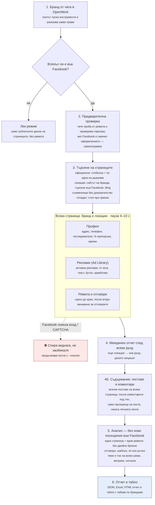

# Facebook бранд профил — какво вадим и защо

Обновено: 25.11.2026 · Жив документ: https://claude.ai/artifact/JpBSyGKPgRKEiCMr7sSdbH

За всяко поле: какво е, защо ни трябва и докъде сме. Отдолу е блок схемата на целия процес.

## Целта

По името на бранда да получим цялостна картина от Facebook в един отчет и едно табло. Всяко поле е тук, защото
отговаря на поне един от тези въпроси:

1. **Кой е брандът и колко е голям?** Официални страници, локации, държави, последователи.
2. **Какво мислят клиентите?** Препоръчват ли го, за какво го хвалят и от какво се оплакват.
3. **Къде е проблемът?** Коя локация, коя тема и от кога.
4. **Грижи ли се брандът за клиентите?** Отговаря ли, колко бързо, ръчно или с шаблон.
5. **Как говори брандът?** Какво публикува, колко често и какво рекламира.

Поле, което не помага на нито един от тези въпроси, не го вадим. Всяко ново посещение във Facebook е време и риск
за акаунта.

## Блок схема на процеса

Обхождането (стъпки 1–4) е единствената част, която ходи във Facebook. Анализът и отчетът (стъпки 5–6) работят
само с вече извлечените данни и могат да се пуснат наново за стари пускания
(`python -m fbreviews finalize output/<папка>`). Пунктираната кутия е какво ще се добави към обхождането на всяка
страница.

## Как е най-добре да се покаже и защо

Отчетът на бранда е подреден като отговор на мениджър: първо извода, после доказателствата.

1. **Изводи за бизнеса**: една основна фраза, 4–8 извода (добро / лошо) и 2–5 следващи стъпки. Пише ги моделът
   само от числата отдолу, без сравнения с „пазара“, за които нямаме данни.
2. **Числата горе**: локации, последователи, ревюта във Facebook, % препоръка, отговори, реклами.
3. **Бранд и локации**: главната страница отделно, после таблица на всички локации за сравнение.
4. **Гласът на клиента**: колко често пишат ревюта (по месеци), какви са (с текст, със снимки, % препоръчват / не),
   после „Добро / лошо“: за какво хвалят и от какво се оплакват, по локации, и сигналите.
5. **Отговорът на бранда**: отговаря ли, на негативните ли, шаблонно ли.
6. **Гласът на бранда**: какво публикува, колко често, какви теми и формати, кое работи (ангажираност на пост и на
   1000 последователи), най-силните постове.
7. **Реакцията на хората**: какво пишат под постовете (въпроси, похвали, оплаквания) и дали брандът им отговаря.
8. **Платеното**: активните реклами.
9. Накрая всички ревюта с филтри и CSV/JSON, за проверка на всеки извод.

Така отговорите на петте въпроса от „Целта“ са подред, а всеки извод отгоре може да се провери в раздела под него.

## Какво вадим и защо

Подредено по въпросите от „Целта“. „Ново“ значи, че е написано и минава на тестови страници, но още не е пробвано
на истински Facebook.

### Страници: кой е брандът и колко е голям

| Какво | Защо ни трябва | Къде се вижда | Състояние |
| --- | --- | --- | --- |
| Официални страници на бранда (глобална + по държава) | Отделят гласа на бранда от локациите. Без тях страницата на бранда се брои като локация и изкривява числата. | Раздел „Бранд“ | Има |
| Всички локации със собствена страница | Оценките и проблемите са по обекти. Средното за бранда крие слабата локация. | „Локации — сравнение“ | Има |
| Обекти без собствена страница | Показват реалния брой обекти, без ревютата на бранда да се броят по няколко пъти. | Статус „без своя страница“ | Има |
| Държава на всяка страница | При брандове в много държави: сравнение по пазари. | „По държави“ и филтър | Има |
| Адрес, град, телефон, сайт, имейл | Свързват страницата с реалния обект и помагат да се отсеят съименниците. | Таблица „Локации“ | Има |
| Категория и ценови диапазон | Позиционират бранда; сравнение с конкуренти от същия вид. | Карти, Excel | Има |
| Харесвания (до последователите) | Размер на аудиторията и база за ангажираността на постовете. | Карти, Excel | Ново — за проверка на живо |
| Синя отметка | Дали страницата е потвърдена; още една защита срещу съименници. | ✔ до името | Ново — за проверка на живо |
| „Обикновено отговаря до…“ | Оценката на Facebook колко бързо отговаря на съобщения. Самите съобщения не са публични. | Пилюла под името | Ново — за проверка на живо |
| Instagram, TikTok, YouTube и др. | Къде още присъства брандът; кандидати за следващи източници. | Линкове под името | Ново — за проверка на живо |
| Работно време | Дали обектът работи; затворен обект обяснява спад в ревютата. | Карти, Excel | Ново — за проверка на живо |
| Дата на създаване и смени на името | История на страницата: нова или стара, ребранд, сливане. | — | Facebook вече не ги показва (проверено на живо, 26.11.2026) |
| Пуска ли реклами в момента | Дали брандът инвестира във Facebook сега. | Пилюла, раздел „Реклами“ | Има (Ad Library) |
| От коя държава я управляват | Кой реално поддържа страницата, например агенция в друга държава. | — | Facebook вече не я показва |

### Ревюта: какво мислят клиентите

| Какво | Защо ни трябва | Къде се вижда | Състояние |
| --- | --- | --- | --- |
| % препоръка и брой ревюта по Facebook | Официалната оценка, която виждат клиентите; базата за сравнение между локации. | Числата горе, таблица | Има |
| Текст на ревюто | Основата на всичко останало: теми, тон, цитати. | „Всички ревюта“ | Има |
| Препоръчва / не препоръчва | Мнението на клиента с една дума. Facebook няма звезди. | Пилюли, графики | Има |
| Точна дата | Тенденция във времето и сигнали за влошаване. | „Ревюта по години“, сигнали | Има |
| Етикети на Facebook | Готови теми, избрани от самия клиент. | „Най-чести етикети“ | Има |
| Реакции, снимки, брой коментари | Колко хора са подкрепили ревюто; кои ревюта тежат повече. | Под всяко ревю | Има |
| Линк към ревюто | Проверка на източника с един клик. | „виж във Facebook ↗“ | Има |

### Отговори: грижи ли се брандът

| Какво | Защо ни трябва | Къде се вижда | Състояние |
| --- | --- | --- | --- |
| Отговор от страницата под ревюто | Дали брандът изобщо реагира на клиентите. | Под ревюто | Има |
| Шаблон, AI или ръчен отговор | Дали отговорът е автоматичен или човек се е ангажирал с проблема. | Пилюли, Excel | Има |
| Коментари на други хора под ревютата | Facebook показва само броя им, не текста, затова пазим броя. | Брой под ревюто | Има |

### Анализ: къде е проблемът (от вече извлеченото, без нови посещения)

| Какво | Защо ни трябва | Къде се вижда | Състояние |
| --- | --- | --- | --- |
| Тон на всяко ревю | „Препоръчва“ с оплакване в текста е неутрално. По-точно е от да/не. | „Теми“ | Има |
| Теми с плюс и минус | За какво точно хвалят и от какво се оплакват, по локации. | „Теми“ | Има |
| Резюме в едно изречение | Бърз прочит на стотици ревюта. | Под ревюто | Има |
| % отговорени, отговорени негативни, негативни без отговор | Грижата в числа. Негативните без отговор са най-големият риск за репутацията. | „Отговаряне“ | Има |
| Време за отговор | Колко бързо реагира брандът. Приблизително, защото Facebook дава груби дати. | „Отговаряне“ | Има |
| Сигнали | Къде да се гледа първо: локация, която се влошава, тема, която расте, пренебрегнати оплаквания. | Карти в „Теми“ | Има |

### Съдържание: как говори брандът

| Какво | Защо ни трябва | Къде се вижда | Състояние |
| --- | --- | --- | --- |
| Реклами (Ad Library) | Какво и откога рекламира; посланията и фокусът на бюджета. Публично, без вход. | Раздел „Реклами“ | Има |
| Постове на бранда и локациите | Какво публикува, колко често, какви теми и формати, кое събира реакции. | Раздел „Постове“ | Има |
| Коментари под постовете | Въпроси и оплаквания извън ревютата; отговаря ли брандът и там. Facebook ги зарежда (за разлика от тези под ревютата). | Раздел „Коментари“ | Има (без рийлове) |

## Какво не вадим и защо

- **Самите снимки.** Пазим броя им и линк. Изображенията носят авторски права и лица на хора, а обемът е голям.
- **Профилите на авторите на ревюта.** Не допринасят за картината за бранда, а са лични данни (GDPR). Името на автора
  се пази, но ще може да се скрие в отчетите, които се дават навън.
- **Съобщенията до страницата.** Не са публични. Виждаме само оценката на Facebook „Обикновено отговаря до…“.
- **Текстът на коментарите под ревютата.** Facebook не ги зарежда в нито един браузър или профил, включително в
  приложението. Пазим броя и отговорите на страницата, които се виждат под ревюто.
- **Отметки за посещения, събития, споменавания.** Рядко се показват и дават малко за много нови посещения.
- **Нищо зад вход или CAPTCHA.** Инструментът само чете и спира, ако Facebook поиска проверка. Не я заобикаля.
- **Извън Facebook.** Google ревютата са най-големият липсващ източник за пълна картина. Това е за отделен скил.

## Състояние

| Етап | Какво | Нови посещения във Facebook | Състояние |
| --- | --- | --- | --- |
| 1 | Теми, тон, резюме, метрики за отговаряне, сигнали | няма | готово |
| 2 | Профил+: последователи, харесвания, отметка, значка за отговаряне, мрежи, работно време, обектите от описанието | няма | готово, проверено на живо |
| 3 | Реклами от Ad Library | 1 на страница | готово, проверено на живо |
| 4 | Постове на бранда и локациите | 1 на страница + скрол | готово, проверено на живо |
| 5 | Коментари под постовете | 1 на пост с коментари | готово, проверено на живо (без рийлове) |
| — | Изводи за бизнеса от модела | няма | готово |

Постовете и коментарите се вадят след ревютата на всички страници, в отделни рундове. Изключват се с `--no-posts`.
